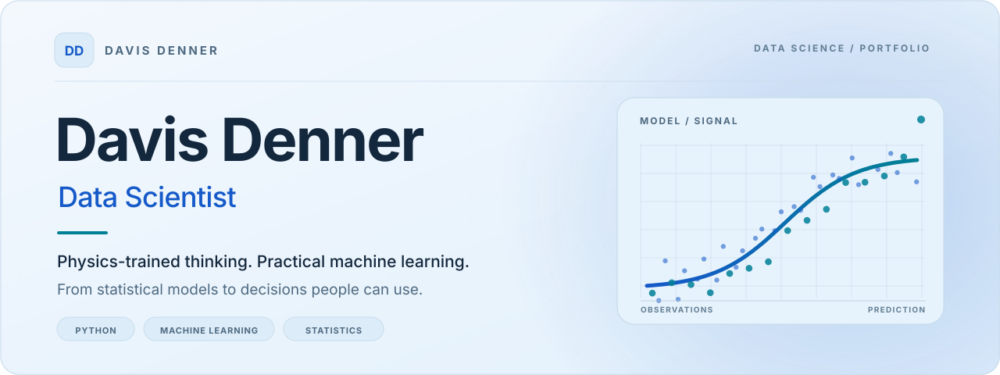
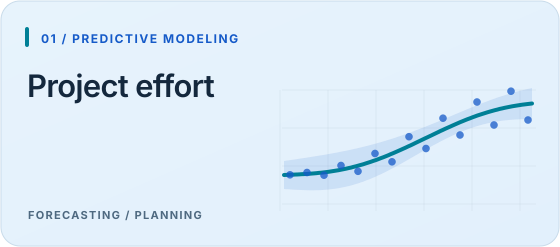
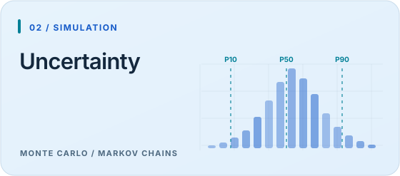
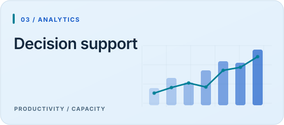

<!-- DAVIS DENNER: GitHub Profile README. All visuals are self-hosted in /assets. -->

  <picture>
    <source media="(prefers-color-scheme: dark)" srcset="./assets/header-dark.svg" />
    <source media="(prefers-color-scheme: light)" srcset="./assets/header-light.svg" />
    
  </picture>

   

  **Applied machine learning · Statistical modeling · Decision-focused analytics**

  I use mathematics, code, and curiosity to make complex information useful.

  [**LinkedIn**](https://www.linkedin.com/in/davis-denner-costa-silva-4536a51b0/) &nbsp;·&nbsp; **Python** &nbsp;·&nbsp; **SQL** &nbsp;·&nbsp; **Machine Learning**

 

## A little about me

I'm a **Data Scientist** with a degree in **Physics** and postgraduate training in **Data Science at PUC-Rio**. My background shapes the way I approach problems: start with the underlying assumptions, test ideas against data, and keep the result understandable to the people using it.

I work across the full analytical process, from preparing data and developing predictive models to designing interactive tools that help teams plan, monitor, and make decisions. My interests sit where **statistical reasoning, machine learning, and practical business questions** meet.

## Selected work

*A few examples of the problems I've worked on, described at a high level without proprietary data or source code.*

<table>
  <tr>
    <td width="42%">
      <picture>
        <source media="(prefers-color-scheme: dark)" srcset="./assets/forecasting-dark.svg" />
        <source media="(prefers-color-scheme: light)" srcset="./assets/forecasting-light.svg" />
        
      </picture>
    </td>
    <td valign="middle">
      <strong>Forecasting project effort</strong>
        
      Applied regression models, including <strong>XGBoost</strong>, to estimate project hours from historical and project-level features. Used evaluation measures such as R², RMSE, and MAPE to understand predictive performance and support planning discussions.
        
      <code>Python</code> <code>XGBoost</code> <code>Regression</code>
    </td>
  </tr>
  <tr>
    <td width="42%">
      <picture>
        <source media="(prefers-color-scheme: dark)" srcset="./assets/simulation-dark.svg" />
        <source media="(prefers-color-scheme: light)" srcset="./assets/simulation-light.svg" />
        
      </picture>
    </td>
    <td valign="middle">
      <strong>Modeling uncertainty and scenarios</strong>
        
      Used <strong>Monte Carlo simulation</strong> and <strong>Markov chains</strong> to explore possible outcomes, transitions, and planning scenarios. I value probabilistic views that show a range of possibilities rather than a single number without context.
        
      <code>Statistics</code> <code>Monte Carlo</code> <code>Markov chains</code>
    </td>
  </tr>
  <tr>
    <td width="42%">
      <picture>
        <source media="(prefers-color-scheme: dark)" srcset="./assets/analytics-dark.svg" />
        <source media="(prefers-color-scheme: light)" srcset="./assets/analytics-light.svg" />
        
      </picture>
    </td>
    <td valign="middle">
      <strong>Operational analytics and decision support</strong>
        
      Developed SQL-driven analyses and interactive dashboards to monitor productivity, capacity, and project delivery. Focused on translating operational data into indicators that teams can actually use.
        
      <code>SQL</code> <code>PostgreSQL</code> <code>Dash</code> <code>Plotly</code>
    </td>
  </tr>
</table>

## How I approach data problems

**Understand the decision** → **Build a useful baseline** → **Validate what the model learns** → **Communicate uncertainty** → **Make the result usable**

I care about both technical rigor and practical adoption. A model is most valuable when its assumptions, limitations, and outputs are clear enough to guide a real decision.

## Toolkit

| | Tools & methods |
| :-- | :-- |
| **Programming & data** | Python · SQL · PostgreSQL · pandas · NumPy |
| **Machine learning** | scikit-learn · XGBoost · Regression · Model evaluation |
| **Statistics & simulation** | Statistical modeling · Monte Carlo · Markov chains |
| **Visualization & delivery** | Dash · Plotly · Power BI · Streamlit |
| **Currently exploring** | Databricks · Data Engineering · MLOps |

## Education

**Postgraduate Degree in Data Science**: Pontifical Catholic University of Rio de Janeiro (**PUC-Rio**)

**Graduate in Physics**: Federal Institute of Tocantins (**IFTO**)

---

  **Good data science doesn't end at a prediction. It helps someone make a better decision.**

  Interested in connecting? [Find me on LinkedIn](https://www.linkedin.com/in/davis-denner-costa-silva-4536a51b0/).

  Designed with care · Davis Denner

